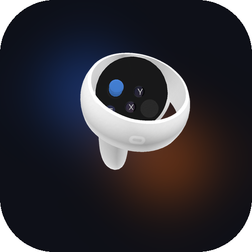
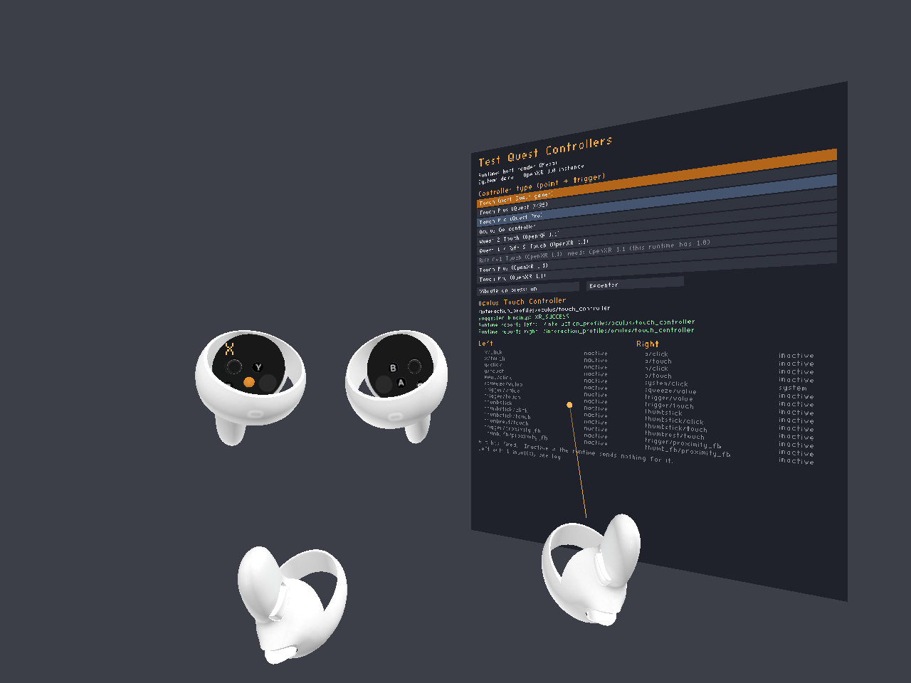
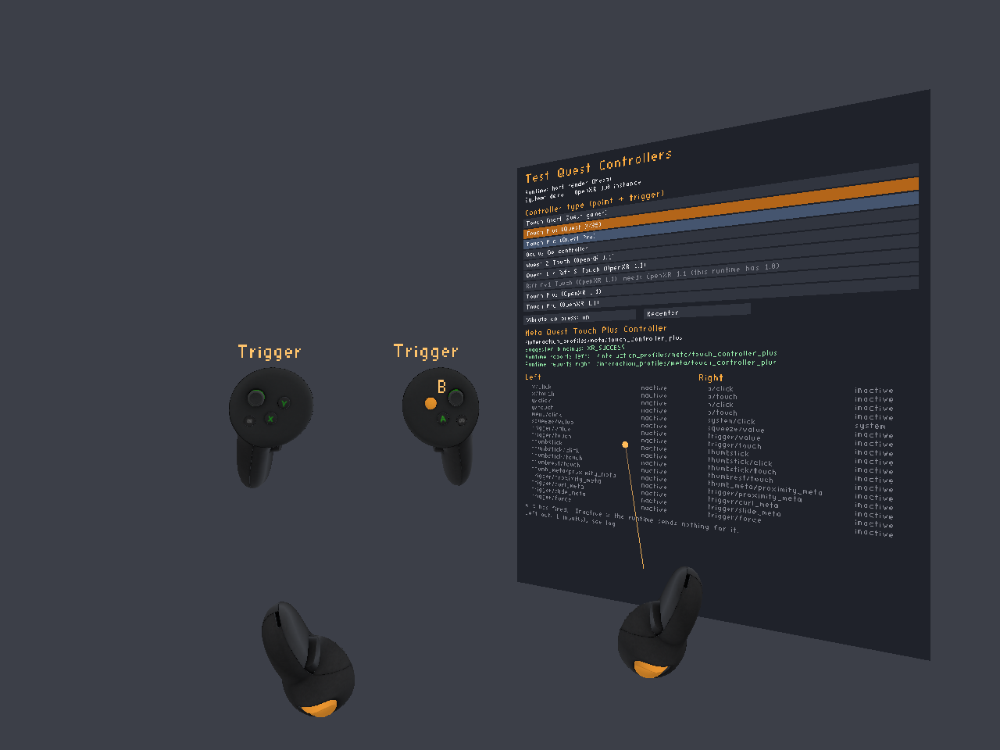
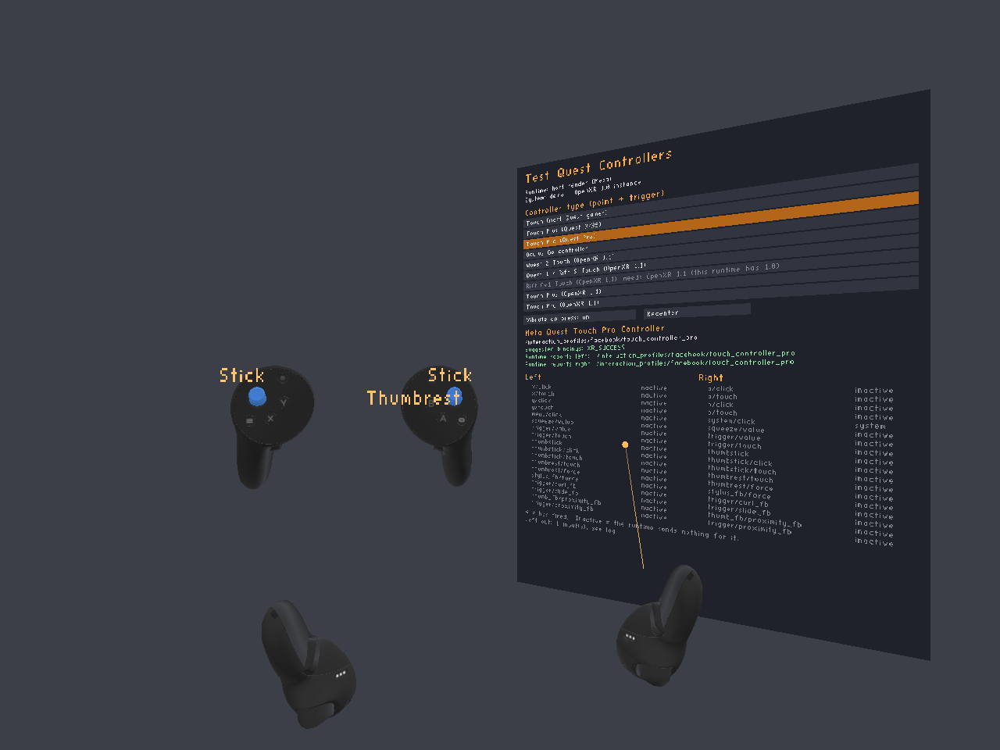
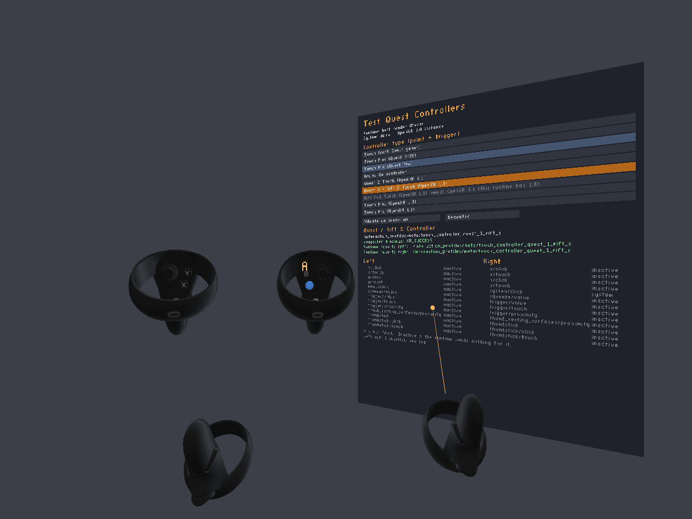
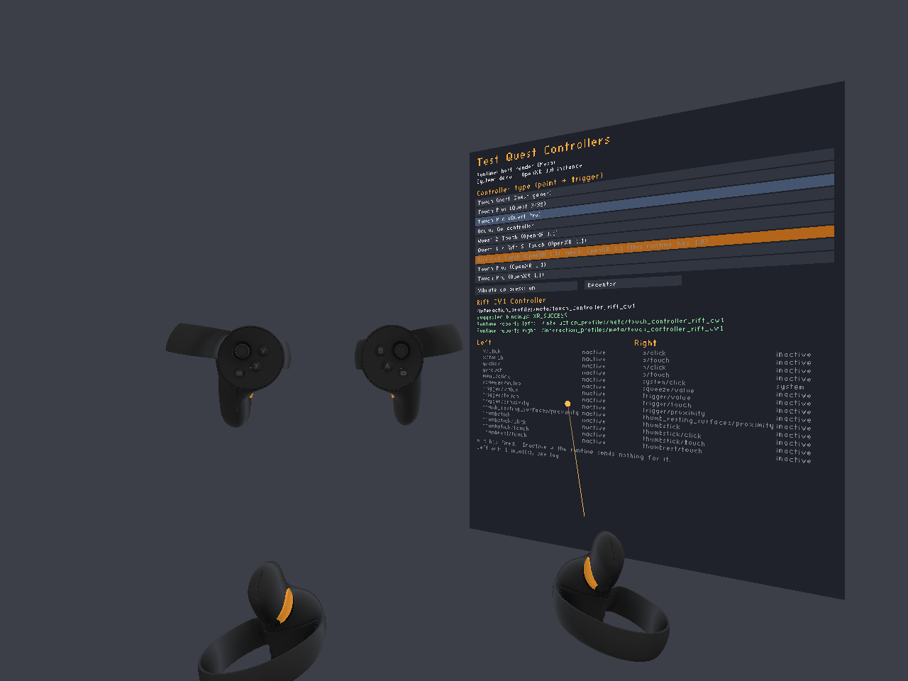
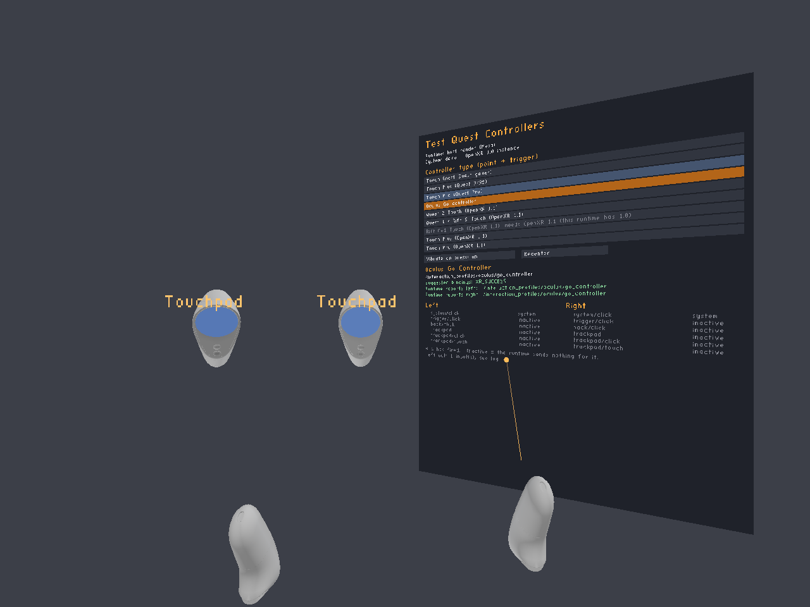

<p align="center"></p>

# Test Quest Controllers

[](https://frameport.app/install?manifest=https%3A%2F%2Fgithub.com%2Fspoopyghosty0%2FTestQuestControllers%2Freleases%2Flatest%2Fdownload%2Fframeport-install.json)

Needs [FramePort](https://frameport.app) (Steam Frame). On a Quest: [download the APK](https://github.com/spoopyghosty0/TestQuestControllers/releases/latest) and sideload it.

A small OpenXR app that shows how a headset handles Quest controller input. Pick a Quest controller type and the app
behaves like a game made for that controller: it asks the runtime for that controller's buttons only, then lights up a
3D model of it for every input it receives, in your hands and as an enlarged pair in front of you.

Use it to see what a game made for a Quest controller would get on your headset: which buttons arrive, which don't,
whether touch and analog values come through, and which controller the runtime says you're holding. This is useful
wherever Quest controllers are emulated or remapped (for example the Steam Frame through FramePort or another
converter), and on a real Quest as the reference.



| | |
|---|---|
|  **Touch Plus** (Quest 3/3S) |  **Touch Pro** (Quest Pro) |
|  **Quest 1 / Rift S Touch** |  **Rift CV1 Touch** |
|  **Oculus Go controller** | |

*Demo mode (parts light up in turn), rendered on a PC from the app's own drawing code with `tools/render_host`.*

## Controller types

| In the app | Interaction profile | Needs |
|---|---|---|
| Touch (most Quest games) | `/interaction_profiles/oculus/touch_controller` | — |
| Touch Plus (Quest 3/3S) | `/interaction_profiles/meta/touch_controller_plus` | `XR_META_touch_controller_plus` |
| Touch Pro (Quest Pro) | `/interaction_profiles/facebook/touch_controller_pro` | `XR_FB_touch_controller_pro` |
| Oculus Go controller | `/interaction_profiles/oculus/go_controller` | — |
| Quest 2 Touch | `/interaction_profiles/meta/touch_controller_quest_2` | OpenXR 1.1 |
| Quest 1 / Rift S Touch | `/interaction_profiles/meta/touch_controller_quest_1_rift_s` | OpenXR 1.1 |
| Rift CV1 Touch | `/interaction_profiles/meta/touch_controller_rift_cv1` | OpenXR 1.1 |
| Touch Plus (OpenXR 1.1) | `/interaction_profiles/meta/touch_plus_controller` | OpenXR 1.1 |
| Touch Pro (OpenXR 1.1) | `/interaction_profiles/meta/touch_pro_controller` | OpenXR 1.1 |

The inputs of each type come straight from the OpenXR registry (`tools/gen_profiles.py`). The 3D models are the
[WebXR Input Profiles](https://github.com/immersive-web/webxr-input-profiles) assets (Oculus Touch, Touch v2 and
v3, Touch Plus, Touch Pro, Oculus Go), animated the way their profiles describe. Touch also gets the
proximity inputs of `XR_FB_touch_controller_proximity` when the runtime offers it. Types the runtime can't do are
greyed out with the reason. Most Quest games use OpenXR 1.0, so the 1.0 types run on an OpenXR 1.0 instance and the
1.1 types on a 1.1 instance, just as a game would.

## Using it

- **Pick a controller type:** point at the panel and pull the trigger. If pointing doesn't work with the type you
  picked, hold the thumbstick (or touchpad) click for 2 seconds to go to the next type. If a type gives no
  controller input at all for 10 seconds, the app goes back to the last type that worked.
- **Read the model:** blue = touched, orange = pressed, orange that grows with the value = analog input (trigger,
  grip), a faint blue = finger near (proximity). Buttons go in, the trigger and grip move with your fingers, the
  stick tilts and the Go touchpad shows where you touch. Darkened parts aren't bound for this type. Inputs the models
  have no part for (the system button, the left menu button on the newer Touch models, the thumbrest) show in the
  panel only.
- **Read the panel:** the runtime's answer to the bindings ("XR_SUCCESS" or the error), the profile the runtime
  says each hand has, and every input with its live value. A `*` marks inputs that have fired; "inactive" means the
  runtime sends nothing for that input.
- **Vibrate on press** pulses the controller on every newly pressed part (checks that vibration reaches it).
  **Recenter** puts everything in front of you again.
- The chosen type is remembered for the next start.

Every input change is logged with the tag `TQC`, so a session can be checked afterwards (`adb logcat -s TQC`; on
the Steam Frame the line is in the game's log).

**Demo mode:** create an empty file named `demo` in the app's files folder
(`Android/data/io.github.spoopyghosty0.testquestcontrollers/files/`) and the parts light up in turn without a
controller (for screenshots, or for checking the models on a headset nobody wears).

## Building

Needs JDK 17 and the Android SDK (NDK 27.2.12479018 and CMake 3.22.1 are installed by the build when missing).

```
./gradlew assembleRelease           # app/build/outputs/apk/release/
python3 tools/gen_profiles.py       # regenerate the controller table from the OpenXR registry
python3 tools/fetch_models.py       # copy the controller models from the pinned WebXR Input Profiles package
python3 tools/test_tables.py        # the models can show every core input of every controller type

# the app's scene on a PC (Mesa EGL): profile index, demo time in seconds, --hands for controllers in view
cmake -S tools/render_host -B out/render_host && cmake --build out/render_host
out/render_host/render_host app/src/main/assets out/scene.ppm 0 5.3 --hands
python3 tools/gen_icon.py           # the app icon, from the renderer's close-up of the Touch model
```

Releases are built by GitHub Actions from a `v*` tag matching `versionName` in `app/build.gradle.kts`: the APK, the
install manifest the button above opens (`frameport-install.json`) and `SHA256SUMS.txt`.

## Licences

The app is MIT-licensed (`LICENSE`). The controller models are from the
[WebXR Input Profiles](https://github.com/immersive-web/webxr-input-profiles) assets (MIT,
`app/src/main/assets/webxr/LICENSE.md`); as that project notes, they portray the manufacturers' trademarks to depict
the devices accurately, and the licence grants no rights to those marks. Third-party code: the Khronos OpenXR loader
(Apache-2.0, from Maven Central), [cgltf](https://github.com/jkuhlmann/cgltf) (MIT) and
[stb_easy_font / stb_image](https://github.com/nothings/stb) (MIT / public domain). Meta Quest, Touch and Oculus are trademarks
of Meta Platforms; this project isn't affiliated with Meta.
